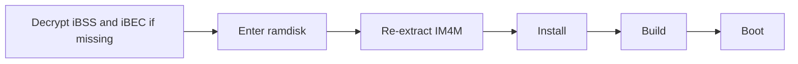

# Historical upstream iPhone 6 Plus guide

This guide describes the upstream **N56AP / iPhone 6 Plus** target. Its feature and test claims are not N61 validation. For this fork's iPhone 6 procedure and limitations, read [the N61 guide](N61.md). Commands below explicitly select `--target n56-ios13` because this fork defaults to N61.

<div align="center">

# n56-patcher

**Build and install tool for running iOS 13.7 as a second system on iPhone 6 Plus (N56AP / iPhone7,1)**

Historical upstream N56 guide — [use the N61 guide for iPhone 6](N61.md)


-5E5CE6?style=flat-square)


[Quick start](#quick-start) · [Features](#features) · [Advanced usage](#advanced-usage) · [Author](#author) · [Support the project](#support-the-project)

</div>

---

By default, the tool rebuilds the KC from a clean J96 kernel and also generates iBSS, iBEC, DeviceTree and TrustCache, for five boot images in total. Kernel and DeviceTree transforms call `patches/impl/` in this repository directly, and firmware inputs live in the local `donors/` directory.

The project has been run end to end. The final boot bundle includes the hardware adaptation, DataB decryption and checkra1n. Technical conclusions are in [conclusions.md](conclusions.md) (translated upstream notes).

> [!WARNING]
> This tool creates volumes and writes system files on your device, so back up first. This project is not affiliated with Apple. It is provided as is, and you use it at your own risk.

## Quick start

### 1. Set up the environment

On macOS with full Xcode installed (the iPhoneOS SDK is required):

```sh
python3 -m pip install -r requirements.txt
python3 tools/setup.py
```

`tools/setup.py` generates `donors/` (the checkra1n userland plus fsck and apfs.fs from iOS 14) and builds gaster from source. The first build needs the device in DFU to decrypt iBSS and iBEC.

Generate the SSH ramdisk once while the device is in DFU (requires internet access):

```sh
cd tools/SSHRD_Script && ./sshrd.sh 12.5.8
```

### 2. Download the IPSWs

Download these files from Apple, keep the file names unchanged, and put them in `ipsw/`:

```text
ipsw/iPhone_5.5_12.5.8_16H88_Restore.ipsw          # N56, used by tools/extract_ipsw.py
ipsw/iPhone_5.5_13.7_17H35_Restore.ipsw            # N66
ipsw/iPad_64bit_TouchID_13.7_17H35_Restore.ipsw    # J96
```

The first time a rootfs is needed, the flow extracts the DMG to `ipsw/cache/` and reuses it afterwards.

### 3. Run the end-to-end flow

On first run or after a restore, put the device in DFU, then run the end-to-end flow or choose the end-to-end action in the web UI:

```sh
sudo python3 n56patcher.py all --target n56-ios13
# Local web UI; stages that write to disk need sudo:
sudo python3 gui.py
```



> [!IMPORTANT]
> - A restore invalidates the old IM4M and old boot bundles. `build` only checks that `state/IM4M.bin` exists, not whether it is stale, so run `extract-im4m` before building on its own.
> - Each web UI stage uses its own `build/` directory, so when you run stages separately `boot` does not reuse the output of `build`. Use the end-to-end action for a fresh install.
> - `--dry-run` only prints the flow. It does not access or write to the device and does not produce build output.
> - The web UI supports the upstream language options, switchable in the top bar. Console logs come from the CLI; the fork is translating its first-party messages into English.

### Local directories

These directories are ignored by Git:

| Directory | Contents |
| --- | --- |
| `ipsw/` | IPSWs you downloaded; the build generates the kernel, DeviceTree, TC, Wi-Fi firmware and Health libraries into `ipsw/cache/derived/` |
| `donors/` | Firmware inputs generated by `tools/setup.py` |
| `state/` | IM4M; `--data-protection none` also needs a self-supplied `state/keybags.tar`, while the default `encrypted` does not |
| `build/` | Build output |

## Features

All features are selected by default. `--features` selects patches across layers by feature, and `--patches` overrides the KC selection only. Dependencies are added automatically.

| Feature | KC patch ID | Pulls in |
| --- | --- | --- |
| `pmu` | `kc.pmu_d2186` | Base KC |
| `touch` | `kc.mt_n56` | PMU, Chestnut |
| `charging` | `kc.sn2400` | PMU |
| `chestnut` | `kc.chestnut_kext` | Base KC |
| `wifi` | `kc.wifi` | Base KC |
| `vibration` | `kc.vibration` | Base KC |
| `sep` | `kc.legacy_sep` | Base KC |
| `audio` | `kc.audio` | Base KC |

## Advanced usage

<details>
<summary><b>Build and boot</b></summary>

```sh
python3 n56patcher.py build --target n56-ios13 --workdir build/current
python3 n56patcher.py boot --target n56-ios13 --workdir build/current
```

Build chain:

```text
Clean J96 KC → generic boot patches → D2207 PMU adaptation → SN2400 → Chestnut
             → N56 touch → Wi-Fi → DRV2604 → SEP compatibility → CS42L67
             → complzss + watchtower → boot_KC.img4
```

DeviceTree is rebuilt from the original N56 iOS 12 and N66 iOS 13 JSONC.

TrustCache starts from the full repair-v7 set, then adds the mrm generated on site, the final Health libraries, the Bluetooth/SEP services and the combined dyld cache cdhash.

The Health overlay first deploys all non-Mach-O resources of the 50 target bundles from N66 17H35, then overwrites them with the binaries fixed by repair-v7, which keeps the Core Data models, plists, assets and localizations complete.

The `ui` overlay deploys Health, Phone and Wallet from N66 17H35, overwrites every missing or differing iPhone Settings resource and settings bundle binary, and adds the boot logo, app icons and wallpapers. App bodies are only accepted from N66 iOS 13.7.

KC, iBSS and DeviceTree from a clean build are byte-identical to the on-device boot bundle. iBEC embeds the boot-args, which no longer include `serial=3` by default; override them with `--bootargs` when you need serial logs. TrustCache is paired with the rootfs written by the same build, so an installed device keeps using its own boot bundle. See the [technical conclusions](conclusions.md#trustcache-pairing) (translated upstream notes).

</details>

<details>
<summary><b>Cherry-pick</b></summary>

```sh
# Show the actual patch list when selecting only Wi-Fi and audio
python3 n56patcher.py list --target n56-ios13 --patches kc.wifi,kc.audio
# Build these two KC patches
python3 n56patcher.py build --target n56-ios13 --patches kc.wifi,kc.audio --workdir build/wifi-audio
# Select touch by feature; PMU and Chestnut are pulled in automatically
python3 n56patcher.py build --target n56-ios13 --features core,touch --workdir build/touch
# All default features minus audio
python3 n56patcher.py build --target n56-ios13 --exclude kc.audio --workdir build/no-audio
```

`--patches` selects KC patches exactly, while rootfs still follows `--features`. `--patches ''` produces the base KC. In the GUI, tick the features you need and the execution order is arranged automatically.

</details>

<details>
<summary><b>Install the second system step by step</b></summary>

The volume layout is `disk0s1s4` SystemB and `disk0s1s5` DataB.

```sh
python3 n56patcher.py ramdisk --target n56-ios13
python3 n56patcher.py extract-im4m --target n56-ios13
sudo python3 n56patcher.py install --target n56-ios13 --workdir build/current
python3 n56patcher.py build --target n56-ios13 --workdir build/current
python3 n56patcher.py boot --target n56-ios13 --workdir build/current
```

DataB uses encrypted content protection by default, and the install flow creates the systembag automatically. Cydia is installed with the `checkra1n` feature and needs internet access to download. It finishes configuring itself about 30 seconds after first boot.

The install flow also corrects how `installd` handles an empty Application container set, so the first free-signed app can install.

Overlays are generated directly from SystemA and the N66/J96 rootfs. If the IPSWs are not in `ipsw/`, pass their paths explicitly:

```sh
sudo python3 n56patcher.py install --target n56-ios13 \
  --n66-ipsw /path/to/iPhone_5.5_13.7_17H35_Restore.ipsw \
  --j96-ipsw /path/to/iPad_64bit_TouchID_13.7_17H35_Restore.ipsw
```

The current profile targets SystemA 16H88 and N66/J96 17H35. The flow checks the build, key file digests and the original bytes of every byte patch.

</details>

<details>
<summary><b>Source layout</b></summary>

- `targets/`: device, input paths and feature selection.
- `patches/kc/`, `patches/dt/`, `patches/rootfs/`: build and install steps.
- `patches/impl/`: source and ABI maps that actually modify the kernel, drivers and DeviceTree.
- `core/`: dependency ordering, path resolution, tool invocation, ramdisk and APFS.
- `tools/`: pinned upstream submodules plus setup and input import tools. See [UPSTREAM.md](../tools/UPSTREAM.md).

</details>

## Author

**CelestialSayuki (CelestialSayuki)**, electronic engineering student at the University of Electronic Science and Technology of China (UESTC) and Apple developer.

| Platform | Account |
| --- | --- |
| GitHub | [@CelestialSayuki](https://github.com/CelestialSayuki) |
| X | [@CelestialSayuki](https://x.com/CelestialSayuki) |
| Telegram | [@CelestialSayuki](https://t.me/CelestialSayuki) |
| Bilibili | [CelestialSayuki](https://space.bilibili.com/514518697) |
| Email | [CelestialSayuki@qq.com](mailto:CelestialSayuki@qq.com) |
| Website | [infodrop.cn](https://infodrop.cn) |

## Support the project

If this project helped you, [tips are welcome](../DONATE.md).

## License

This project is licensed under [GPL-3.0](../LICENSE). `tools/checkra1n-kpf/` keeps the upstream PongoOS MIT license, as stated in its file headers, and submodules follow their own upstream licenses. The repository contains no Apple firmware, and IPSWs are not covered by this license.
